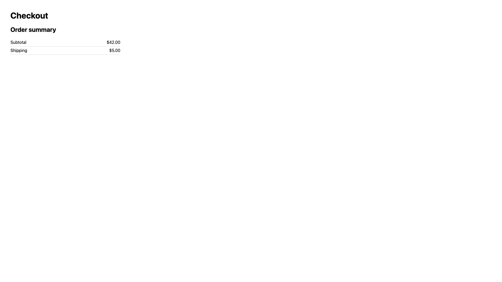

# What we learned about Kane CLI while building on it

Kane Judge calls a claim *proven* only when Kane passes a flow, so a pass that isn't real is the worst thing that can happen to it. Building it turned up two ways Kane CLI 0.10.5 reports a pass without the thing being true. Both reproduce from [`examples/kane-findings`](../examples/kane-findings), every run we made is in [`trials.md`](../examples/kane-findings/trials.md), and Kane Judge defends against both.

Measured on 18 Nov 2026 with Kane CLI 0.10.5 (model `v16-alpha` in the evidence pack), Chrome 156, macOS.

## 1. A check sometimes passes on text that is in the page but not displayed

The page ([`site/index.html`](../examples/kane-findings/site/index.html)) has a Total row with `style="display:none"`. A shopper sees Subtotal and Shipping only.

The flow says: *"Verify the Order summary shows a Total row with the amount $47.00."*

The same flow against the same page gets different answers from run to run:

| How the flow was run | Fresh runs | Passed (wrong) | Failed (right) |
| --- | --- | --- | --- |
| Default assertion mode, `testrun run` | 4 | **1** | 3 |
| `--assertion-mode visual`, `testmd run` | 3 | **2** | 1 |
| Replay of a run that had recorded a pass | 4 | **4** | 0 |
| Check reworded to "visibly displayed … (not merely present in the page's HTML)" | 6 | 0 | 6 |

Three things follow from that table.

- **It is intermittent.** Kane's own failure messages show it can see the difference: "The Total $47.00 row exists only as hidden content and is not visible in the Order summary." In other runs of the same flow it passes.
- **`--assertion-mode visual` did not prevent it.** In the two visual-mode runs that passed, the evidence pack records the analyze step as `ANALYZE(textual_visual, …)` and a passed assert step. This is the screenshot Kane saved for that passing assert:

  

- **A false pass sticks.** A passing run is recorded and replayed. All four replays of a recorded false pass passed again, in about ten seconds each. A run that failed is not recorded, so the next run authors the flow afresh.

Wording the check around what a shopper can see fixed it in every run we made: six of six failed as they should, three of them with a message like "The shopper-visible summary shows only Subtotal and Shipping; no Total row or $47.00 is displayed."

We first hit this in our own sample shop. An early version of its bug hid the Total with CSS, and Kane reported the promo flow as passing. The sample now removes the row from the page instead, so that its bug doesn't depend on this behaviour.

**What Kane Judge does about it**
- The skill has the agent write every check about what is *visibly* shown.
- Kane Judge saves the final screenshot of every passing flow and a step-by-step replay, and the agent has to open the screenshot and confirm it shows what the check says before a claim counts as proven. A pass the screenshot doesn't back is treated as a wrong test: the check is reworded and the flow runs again.
- The scorecard embeds the replay, so a human can check the same thing in a few seconds.

## 2. `testrun run` reports a flow with no steps as passed

[`03-no-steps_test.md`](../examples/kane-findings/flows/03-no-steps_test.md) has valid frontmatter, but its body is a numbered list instead of `## ` steps. Its only "check" asks for a Total of $999.00, which is nowhere on the page.

It was reported as passed in 3 runs out of 3:

```text
$ kane-cli testrun run flows/03-no-steps_test.md --agent --headless
{"type":"testrun_authored_member_end","path":"flows/03-no-steps_test.md","status":"passed","duration_s":5}
{"type":"testrun_summary","totals":{"tests":1,"passed":1,"failed":0,"broken":0,"skipped":0,"authored":1}}
exit code 0
```

stderr shows that something went wrong, but an agent reading the NDJSON and the exit code sees one passed test:

```text
warn: ATM test creation failed: Cannot read properties of undefined (reading 'objective')
evidence: sealed pack … failed L1 validation [ { code: 'l1.steps.missing', … message: 'L1 requires a steps/ directory' } ]
```

`kane-cli testmd run` on the same file behaves differently: it prints `info: no steps in …; nothing to run.` and reports no test.

This is how we found it: in a test on a clean Claude Code profile, the agent wrote four flows as numbered lists. Kane returned "4 passed" in 8 seconds, and our CLI told the agent to record four proven claims. (The agent noticed the empty step lists and didn't.)

**What Kane Judge does about it**
- `kane-judge run` checks every flow before it calls Kane: a start URL, a claim tag, at least one `## ` step, and a check in every step. A malformed flow is refused with the format shown, and nothing runs.
- A member Kane reports as passed whose own event log shows no steps is recorded as `no-steps`, never as passed.
- `kane-judge report` refuses a *proven* claim unless Kane's evidence pack holds at least one passed assert step for its flow.
- Kane's own verdict engine catches it too. Kane Judge runs `kane-cli evidence verdict` on every sealed pack with [`policies/claims.yaml`](../policies/claims.yaml), and the gate on Kane's `metrics.tests_without_checks` metric fails a run in which a flow passed without an assert step.

## Smaller notes

- **`testrun run` has no `--assertion-mode` flag.** `kane-cli run` and `kane-cli testmd run` take one; for `testrun run` the mode comes from the global config (`kane-cli config set-assertion-mode`). The config hint still calls `visual` the default, while 0.10.5 defaults to `dom`.
- **Adaptive heal can leave state behind.** When a replayed step failed, the heal re-ran earlier steps in the same browser, and the cart ended up with two pens. Kane's triage correctly called it a test-data issue. Kane Judge's skill asks for checks that stay true either way ("a 10% discount of the shown subtotal"), or for a precondition check first.
- **Kane's bug verdict judges the test against the app.** That is the right job for a test runner, and it is a different question from the judge's: is the *claim* true? When a README promises a page that doesn't exist, Kane says "not a product bug: the test expected a page that isn't there". For a judge that is exactly an overclaim. Kane Judge shows Kane's bug verdict on the scorecard and lets the agent overrule it with Kane's own screenshot as the evidence.
- **An evidence pack stays valid without the account in it.** Kane writes the signed-in account into four kinds of file in a pack (`result.yaml`, `logs/tui.log`, the run logs, `auteur/`). With those emptied in place, `kane-cli evidence validate` still reports the pack valid (L1) and `kane-cli evidence verdict` still judges it, with no account and no credits. `kane-judge share` relies on this to make packs that can be committed.
